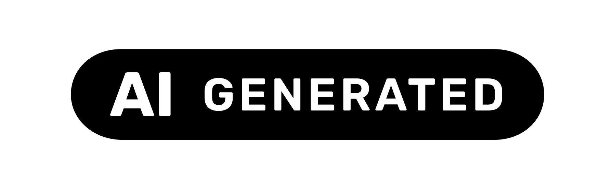
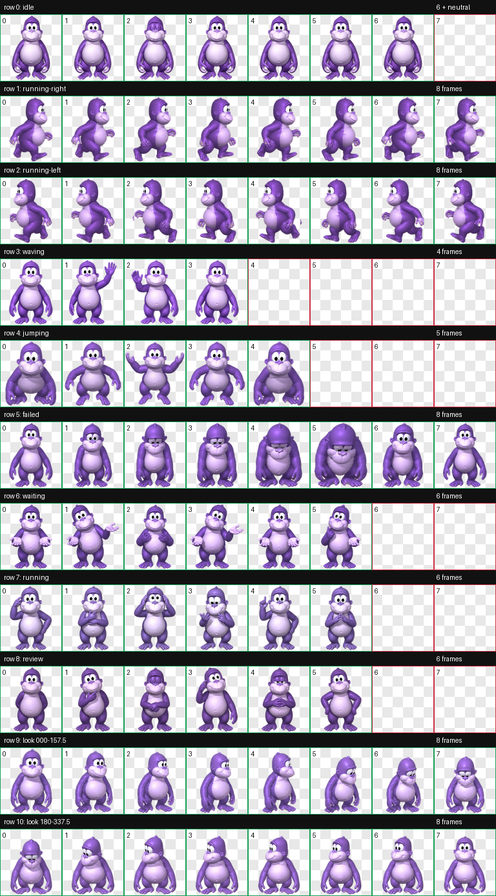
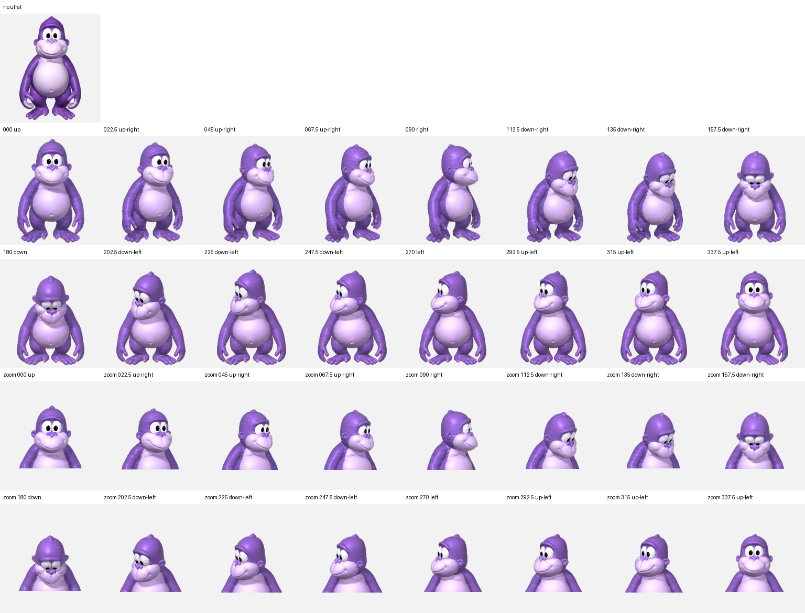

# Bonzi for ChatGPT (Codex)

[Türkçe README](README.tr.md)

<p align="center">
  
</p>

An unofficial, fan-made animated Bonzi pet package for the Codex desktop app. It includes a Codex marketplace plugin, a prompt-driven installer skill, direct macOS/Linux and Windows installers, and the validated v2 pet assets.

> This installs a **Codex desktop pet**. It does not add Bonzi to the regular ChatGPT web interface.



## What is included

- 8×11 Codex v2 atlas (`1536×2288`, transparent WebP)
- 9 standard animation states
- 16 clockwise look directions
- `spriteVersionNumber: 2` pet manifest
- SHA-256 verified installers
- Codex plugin marketplace metadata and an install skill

No external connector plugin, API key, or account integration is required.

## One-prompt Codex app install (no command line)

Open a new Codex task and paste the prompt below exactly. The user does not open a terminal or type commands; Codex performs the download, verification, and local installation with its own tools. You may only need to approve Codex's standard network and pet-folder permission requests.

```text
Install the Bonzi pet in the Codex desktop app. Perform the entire operation with your own local file and terminal tools; do not ask me to open the Terminal app or manually run any command.

Use the immutable v1.0.0 GitHub release. Download only these two files:

1. pet.json
https://raw.githubusercontent.com/eymndev/bonzi-for-chatgpt/v1.0.0/plugins/bonzi-for-chatgpt/assets/pet/bonzi/pet.json

2. spritesheet.webp
https://raw.githubusercontent.com/eymndev/bonzi-for-chatgpt/v1.0.0/plugins/bonzi-for-chatgpt/assets/pet/bonzi/spritesheet.webp

Expected SHA-256 values:
- pet.json: 5aab8bddc9e0cd01042b6667843abe1a38bb049b94c9e1bbc081bc57bd5e9a0b
- spritesheet.webp: 6171db4dffa833c4ed6d1cde4828753f92a4209498431502b0860fc5dfbcc145

Download both files into a newly created temporary directory first. If network or filesystem access needs permission, show the normal Codex approval request and continue after approval. If either SHA-256 value does not match exactly, install or change nothing and report the error. Parse pet.json and verify that id is "bonzi", spriteVersionNumber is 2, and spritesheetPath is "spritesheet.webp".

The installation destination is pets/bonzi inside CODEX_HOME when CODEX_HOME is set; otherwise use $HOME/.codex/pets/bonzi on macOS/Linux or .codex\pets\bonzi inside the Windows user profile. If the destination already contains both files with the expected hashes, make no changes and report that the installation is ready. If pet.json or spritesheet.webp differs, copy only those existing files into a timestamped bonzi-backup-* directory beside the pet directory; do not delete or change other pets, unexpected files, or Codex settings. This prompt explicitly authorizes backing up and replacing those two Bonzi files with the verified release.

Install the verified files, recheck both installed SHA-256 values, and report the exact destination, whether a backup was created, and the final verification result. Finally, tell me to relaunch the Codex desktop app if the pet is not visible yet.
```

The same prompt is available as [INSTALL-PROMPT-EN.txt](INSTALL-PROMPT-EN.txt). Turkish version: [INSTALL-PROMPT-TR.txt](INSTALL-PROMPT-TR.txt).

## Alternative: install through Codex plugins

```bash
codex plugin marketplace add eymndev/bonzi-for-chatgpt
codex plugin add bonzi-for-chatgpt@bonzi-for-chatgpt
```

Start a new Codex task, then paste:

```text
Use $install-bonzi-pet to install the bundled Bonzi pet into Codex and verify it. If a different Bonzi pet would be overwritten, ask me first.
```

If the pet is not visible immediately, relaunch the Codex desktop app.

## Direct install

macOS/Linux:

```bash
git clone https://github.com/eymndev/bonzi-for-chatgpt.git
cd bonzi-for-chatgpt
./install.sh
```

Windows PowerShell:

```powershell
git clone https://github.com/eymndev/bonzi-for-chatgpt.git
Set-Location bonzi-for-chatgpt
./install.ps1
```

The installer writes only to `${CODEX_HOME:-$HOME/.codex}/pets/bonzi`. A non-identical existing package is never replaced unless `--force` (or `-Force`) is explicitly supplied.

## Update

```bash
codex plugin marketplace upgrade bonzi-for-chatgpt
codex plugin add bonzi-for-chatgpt@bonzi-for-chatgpt
```

Start a new Codex task and run the same installation prompt.

## Uninstall

```bash
./uninstall.sh --yes
```

Windows:

```powershell
./uninstall.ps1 -Yes
```

## Verification

```bash
python3 scripts/validate_repo.py
```

The repository validator checks plugin/marketplace structure, manifest values, hashes, and the WebP dimensions.

## Direction QA



## License and trademark notice

Installer code and original documentation are MIT licensed. Bonzi is a Bonzi Software character; the character, name, reference imagery, and generated derivative sprite artwork are excluded from the MIT grant. This project is unofficial and is not affiliated with or endorsed by Bonzi Software, OpenAI, or ChatGPT. See [THIRD_PARTY_NOTICES.md](THIRD_PARTY_NOTICES.md).
